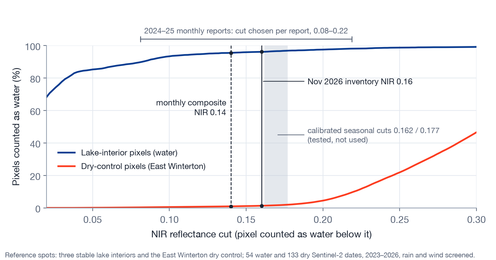

::: {.about-hero}
# About this dashboard

Flooded acreage at Blackrock Waterfowl Management Area (BWMA) supports seasonal water and wildlife management. This site publishes monthly estimates derived from satellite imagery, replacing multi-day field GPS walks for routine monitoring.
:::

::: {.about-grid}
::: {.about-card}
### Data source

Sentinel-2 Surface Reflectance (harmonized collection) via the Google Earth Engine Python API. S2 revisits every ~5 days with 10 m visible/NIR bands used for water detection.
:::

::: {.about-card}
### Method

The **Near Infrared (NIR)** band is thresholded to separate open water from vegetation. Each monthly run uses a **15-day window** starting on the 1st of the month, building a **cloud-masked median composite** across all qualifying scenes—not a single acquisition.

**Since January 2026**, that composite workflow is the official monthly procedure (mid-month run, start date `YYYY-MM-01`, threshold 0.14). Earlier archived reports used the same median code but were often generated on ad-hoc dates; their file names and legacy pages may show a label date that is not a single scene.

Field crews check flooded areas during avian surveys across the flooding cycle (typically September through April).
:::

::: {.about-card}
### Management target

Operational planning references roughly **500 acres flooded** between **November 1 and March 1**. The dashboard chart shows that target as a dashed reference line.

Monthly reports include per-unit acreage for Thibaut, Drew, Waggoner, Winterton sub-units, and Thibaut Ponds.
:::

:::

::: {.about-card #sentinel-1 style="margin-top:1rem"}
### Sentinel-1 (S1) SAR flooded vegetation

Sentinel-2 sees open water but not water under emergent vegetation or under cloud. Since November 2026, the Estimate also counts flooded vegetation mapped from **Sentinel-1 synthetic aperture radar (SAR)**, accepted scene by scene alongside Sentinel-2 open water. Monthly bars through October 2026 are Sentinel-2 only.

- **Sensor and passes.** C-band SAR, Interferometric Wide swath (IW) Ground Range Detected (GRD) scenes (Earth Engine `COPERNICUS/S1_GRD`), 10 m pixels, dual polarization VV and VH in decibels (dB). Each Sentinel-2 date is paired with every radar pass from 2 days before to 3 days after it, on all three relative orbits that cover BWMA: ascending orbit 64 (evening) and descending orbits 71 and 144 (early morning). In November 2026 these were Sentinel-1C and Sentinel-1D passes, one to three per scene date.
- **Change from a dry reference.** Each pass is smoothed (3 × 3 mean in linear power) and compared with the median of the same orbit's July 1 – August 31, 2026 passes. Two changes are used: **dVV**, the change in VV backscatter, and the change in the VV/VH ratio (VV − VH, dB). Both are shifted so the East Winterton dry control reads zero on that pass. Flooding under plants raises VV through double bounce between the water surface and the stems.
- **Flooded-vegetation rule, Estimate.** Mapped vegetation (90th-percentile summer NDVI ≥ 0.30, Sentinel-2, June 1 – September 15, 2026) with mean dVV ≥ 2 dB across the passes, and not radar open water (mean dVV ≤ −3 dB and mean VV ≤ −17 dB).
- **Stricter rule, conservative figure** (in [Notes & methods](flood_reports/reports/bwma_flood_estimate_notes_2026-11-11.html)). Mapped vegetation with mean dVV ≥ 3 dB, mean VV/VH-ratio change ≥ 1 dB, dVV ≥ 2 dB on at least n − 1 of n passes, and not radar open water under the wider test (mean dVV ≤ −2 dB and mean VV ≤ −15 dB).
- **Where radar counts.** Where Sentinel-2 is clear, a pixel is new wet area if it is Sentinel-2 open water (NIR < 0.16) or radar flooded vegetation. Under the Sentinel-2 cloud and shadow mask only radar flooded vegetation can count, on its own ledger line. Each 8-connected patch must be at least 0.5 ac, lie within 20 m of known water or an active ditch, and not sit mostly within 30 m of cloud or shadow. Starting with the Nov 3 scene, radar-only pixels also count only if they are within 20 m of optical water, in a gap enclosed by it, or inside last season's maximum flooded footprint (Nov 1, 2025 – Mar 1, 2026). Radar-only pixels outside all three are reported as possible false alarms and never counted.
- **No double counting.** New area must fall outside the running footprint (the Oct 24 base plus every earlier accepted addition) and inside the counted units, and the radar-under-cloud line may not share a pixel with the clear-sky line. Every accepted scene passed this check with 0.00 ac overlap.
- **What radar adds.** Accepted Nov 1–11 scenes add 188.36 ac to the Estimate; 152.61 ac of that is radar-only (flooded vegetation that was not Sentinel-2 open water on that date), including 5.16 ac under cloud on Nov 1. Approved manual corrections add another 18.84 ac, for 207.20 ac of additions on the 292.40 ac base (Estimate 499.60 ac).
:::

::: {.about-card #nir-cutpoints style="margin-top:1rem"}
### NIR cutpoint research

Open water absorbs near-infrared light, so a pixel counts as water when its Sentinel-2 NIR reflectance (band 8) is below a cutpoint. With NIR as the only signal and one cutpoint per report, the monthly reports from September 2024 through December 2025 adjusted the cut report by report (0.08 to 0.22, shown in each report's header and file name). Those changes were calibrating apparent seasonal effects and trying to capture flooding under vegetation, which is hard to see with NIR alone. Since January 2026 the monthly composite uses 0.14, and the November 2026 cumulative inventory uses 0.16.

In November 2026 we tested the cutpoint on reference spots: the interiors of three stable lakes (Twin Lakes and Goose Lake, at least 25 m inside the shore and water in at least half of the JRC Global Surface Water record) and the East Winterton dry control unit, on 54 water dates and 133 dry dates from 2023 to 2026, leaving out dates with recent rain or wind. Any cut from about 0.12 to 0.19 separates the two well. At 0.16, 96.2% of lake pixels and 1.3% of dry-control pixels count as water (at 0.14: 95.5% and 1.0%). The fitted seasonal cuts were 0.162 (September–February) and 0.177 (March–August). Later tests on the Nov 5 scene tried higher cuts (0.20, 0.24), visible and shortwave-infrared band rules, and LiDAR terrain checks. **None of these calibrated variants is adopted.** Official numbers keep the legacy rule (NIR < 0.16 for the inventory, 0.14 for monthly composites) so they stay comparable with the accepted October 24 base and earlier reports. Now that Sentinel-1 radar adds flooded vegetation as a second, independent source from a different satellite, the NIR cut no longer has to stretch to reach water under plants and can stay fixed.

{fig-alt="Line chart: percent of lake-interior pixels and dry-control pixels counted as water as the NIR cut rises from 0.02 to 0.30, with the 0.14 and 0.16 cuts and the tested 0.162 to 0.177 seasonal band marked." width="100%"}
:::

::: {.about-card #seasonal style="margin-top:1rem"}
### Seasonal adjustments

Before radar, the only way to adjust for the season was to move the single NIR cutpoint. Flooded area now comes from two sources on two different satellites, so the cut can stay stable.

- **Per-report cutpoints, 2024–25.** With NIR as the only signal, the cut was adjusted report by report to calibrate apparent seasonal effects and to reach flooding under vegetation. It ran higher from September through April (0.14–0.22, mostly 0.16 or above) and lower in late spring and summer (0.08–0.10, May–August). NIR alone does not separate flooded vegetation well, so no single cut worked all year.
- **Reflectance conversion.** We checked the Sentinel-2 reflectance conversion; details are in [Notes & methods](flood_reports/reports/bwma_flood_estimate_notes_2026-11-11.html#reflectance-conversion).
- **Seasonal difference measured, not applied.** The reference-spot study found the water/dry break about 0.015 lower in September–February than in March–August (0.162 vs 0.177). The inventory code has a calibrated option that switches cuts by season, but official numbers use the fixed 0.16 rule.
- **Two sources now.** Since November 2026, Sentinel-1 radar maps flooded vegetation from a different satellite, independent of the NIR cut. The cut stays fixed: legacy 0.16 for the inventory and 0.14 for monthly composites since January 2026.
- **Same composite all year.** Each monthly report is a cloud-masked median of all Sentinel-2 scenes in a 15-day window starting on the 1st; the window does not change by season.
- **Season windows.** The 500 ac target applies November 1 – March 1. The dashboard's Season peak card looks only at the current flood season (November 1 – March 31). Radar change is measured against a July–August dry reference, vegetation is mapped from June 1 – September 15 imagery, and the radar check uses last season's November 1 – March 1 maximum footprint.
:::

::: {.about-card #notes-november-2026 style="margin-top:1rem"}
### Notes on the November 2026 entry

The November 2026 bar and the Estimate (**499.60 ac**, latest scene Nov 11, 2026) come from the official cumulative inventory: Sentinel-2 open water plus radar flooded vegetation, accepted scene by scene on top of the corrected Oct 24 base. It includes official correction #4 (Nov 16, 2026): +2.57 ac in the West Winterton north arm from the Nov 11 scene. The November entry is a cumulative inventory, while the earlier bars are monthly Sentinel-2 NIR 15-day median composites. The month-over-month change on the dashboard compares the November Estimate with our best estimate of earlier months, restated with true pixel area: October 2026 is 153.7 ac (Oct 1–16, 6 scenes), so the change is +345.9 ac.

All acreages from the monthly composite reports (2023 through October 2026) are restated (Nov 2026) for the pixel-area correction: the old code counted pixels on a latitude-longitude grid, so totals read about 25% high. Each report was rerun on true 10 m pixel area with its original NIR threshold. Where the original scene (or 15-day composite) could be reproduced within 1.5%, the restated value is the same scene on true area (75 of 88 report files). For 13 report files the original scene set could not be reproduced from the current image archive; those use the 15-day composite rerun and say so on the report page. Every archived report page, its CSV, and its map labels show the restated acres with the originally reported value. Sentinel-1 test pages are not restated and carry a note.

The report shows a single number, the Estimate. The component breakdown, the conservative best estimate, the basemap-ditch versus imagery split, and the display-versus-ledger difference (0.24 ac) are kept in [Notes & methods](flood_reports/reports/bwma_flood_estimate_notes_2026-11-11.html). The Estimate footprint is available as [GeoJSON](flood_reports/reports/bwma_flood_estimate_2026-11-11.geojson) and as a [zipped shapefile](flood_reports/reports/bwma_flood_estimate_2026-11-11_shapefile.zip) (EPSG:32611).
:::
